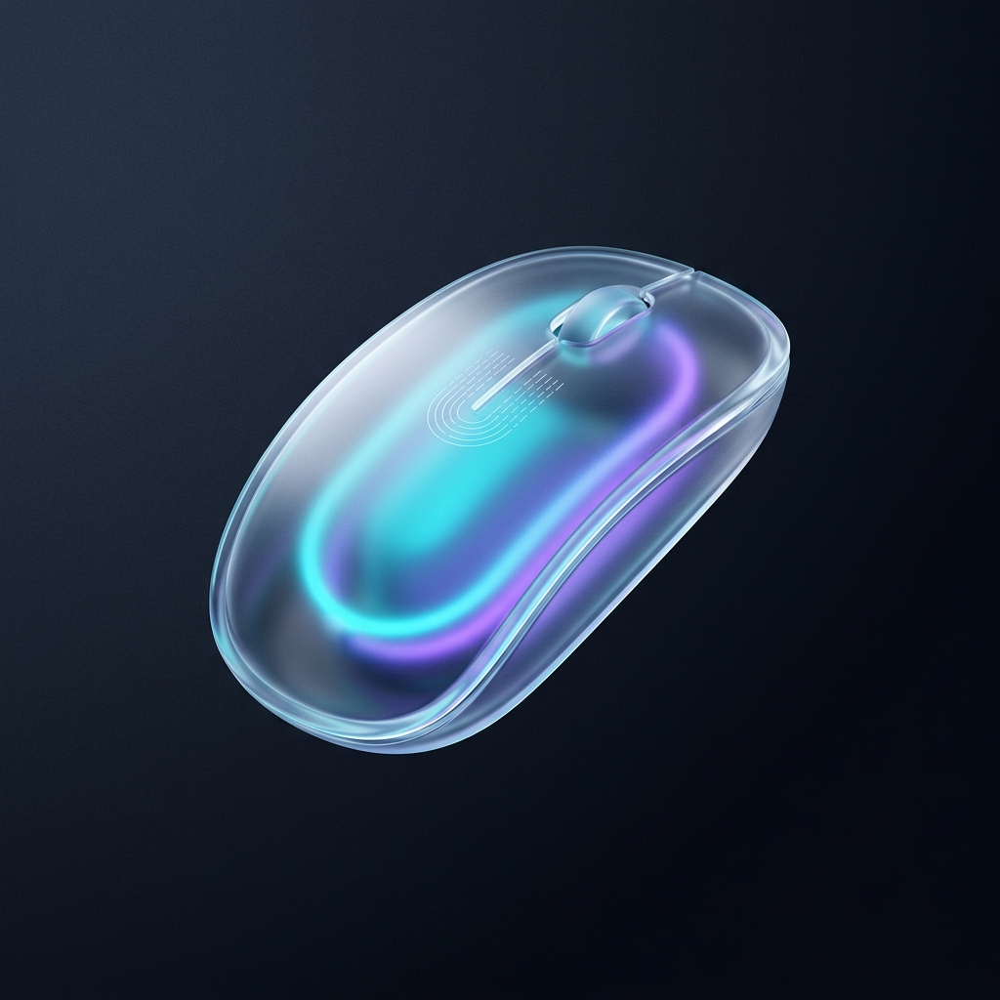

# Velo

<p align="center">
  
</p>

<p align="center">
  <strong>Ultra-responsive PC trackpad, keyboard, and gyro presentation pointer from your phone.</strong>
</p>

<p align="center">
  <a href="https://github.com/nizar-kode/Velo/releases/tag/v1.0.0"></a>
  
  
  
  
  
</p>

---

## Overview

**Velo** is a lightweight, ultra-low-latency remote-control system that transforms your Android smartphone into a wireless trackpad, keyboard, and presentation air-laser pointer for your Windows PC over local Wi-Fi.

No accounts, no external cloud dependencies, and zero data leaves your local network.

* **Velo Desktop**: High-performance native Windows receiver (`Velo.exe`) with a modern Windows 11 Fluent dark companion dashboard (`VeloCompanion.pyw`).
* **Velo Remote**: Premium Android controller with a dark obsidian & neon frosted-glass interface, haptic feedback, and hardware gyroscope pointer.

---

## Downloads (v1.0.0)

Pre-built releases are ready to use with zero compilation:

* 🪟 **Windows PC Receiver**: [**Velo-Desktop-v1.0.0-win-x64.zip**](https://github.com/nizar-kode/Velo/releases/download/v1.0.0/Velo-Desktop-v1.0.0-win-x64.zip) *(Portable standalone package — extract and run!)*
* 📱 **Android Phone App**: [**Velo-Remote-v1.0.0.apk**](https://github.com/nizar-kode/Velo/releases/download/v1.0.0/Velo-Remote-v1.0.0.apk) *(Native APK for Android 8.0+)*

---

## Quick Start Guide

### 1. Windows PC (Velo Desktop Receiver)

1. Download and extract [**Velo-Desktop-v1.0.0-win-x64.zip**](https://github.com/nizar-kode/Velo/releases/download/v1.0.0/Velo-Desktop-v1.0.0-win-x64.zip).
2. Double-click `Start_Velo.bat` (or run `.\Start-Velo.ps1` via PowerShell).
3. Velo starts automatically in your Windows System Tray near the clock.

> [!TIP]
> **Windows SmartScreen Note:**  
> When launching for the first time, Windows Defender SmartScreen may display *"Windows protected your PC"*.  
> Click **"More info"** and then **"Run anyway"**. This prompt is normal for newly released open-source tools that do not carry commercial code-signing certificates.
>
> If your phone cannot discover your computer, right-click `Allow_Firewall.bat` and select **"Run as administrator"** to allow incoming Wi-Fi connections.

### 2. Android Phone (Velo Remote)

1. Download and install [**Velo-Remote-v1.0.0.apk**](https://github.com/nizar-kode/Velo/releases/download/v1.0.0/Velo-Remote-v1.0.0.apk) on your Android device.
2. Connect your phone to the same Wi-Fi network as your PC.
3. Open Velo and tap **Wi-Fi Remote**.
4. Your PC will appear **automatically** in the list via zero-config UDP discovery.
5. Tap your computer name to connect instantly!

---

## Core Features

### 🖱️ Fluid Glassmorphic Trackpad
* Natural finger-gliding cursor physics with smooth multi-touch gestures.
* Two-finger scrolling, tap-to-click, and tactile haptic response.
* Deep space slate surfaces (`#0A0E1A`) accented with soft neon cyan and indigo ambient gradients.

### 🎯 Free-Floating Gyro Air Laser
* Wave your phone in the air like a laser pointer for PowerPoint, Google Slides, or PDF presentations.
* Powered by Android `Sensor.TYPE_ROTATION_VECTOR` sensor fusion with deadzone smoothing.
* Includes dedicated slide presentation controls (`◀ Prev Slide`, `Next Slide ▶`).

### ⚡ Zero-Config LAN Discovery
* Dual-protocol broadcast discovery on UDP port `48292`.
* Automatically resolves local network subnets without requiring manual IP entry.

---

## Architecture

```
┌─────────────────────────────────┐        UDP Beacon (48292)        ┌──────────────────────────────────┐
│      Velo Remote (Android)      │ ◄──────────────────────────────► │       Velo Desktop (Windows)     │
│                                 │                                  │                                  │
│  • Frosted Glass Compose/XML UI │     TCP Mouse Stream (48291)     │  • Native C++ Socket Receiver    │
│  • Gyroscope Pointer Engine     ├────────────────────────────────► │  • Win32 SendInput Event Engine  │
│  • Tactile Haptics Subsystem    │                                  │  • Windows 11 Fluent Tray        │
└─────────────────────────────────┘                                  └──────────────────────────────────┘
```

---

## Building from Source

### Android Client
Requires Android Studio / Android SDK (API 34+):
```bash
cd Mousedroid/client
./gradlew assembleDebug
```

### Windows Receiver
The pre-compiled native engine is in `Velo_Windows_Portable/` and requires no additional compiler. To launch the launcher directly:
```powershell
.\Start-Velo.ps1
```

---

## Acknowledgments & Heritage

Velo builds upon the open-source architecture originally created by [darusc (Mousedroid)](https://github.com/darusc/Mousedroid), enhancing it with a glassmorphic visual system, multi-adapter LAN auto-discovery, gyroscope sensor filtering, and a modern Windows 11 companion.

---

## License

This project is licensed under the [MIT License](LICENSE).
